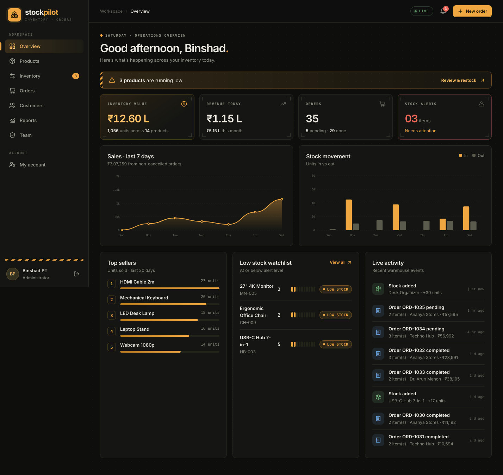
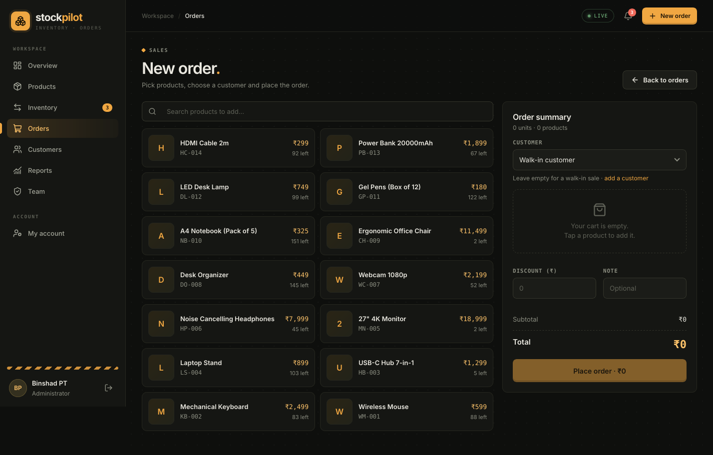
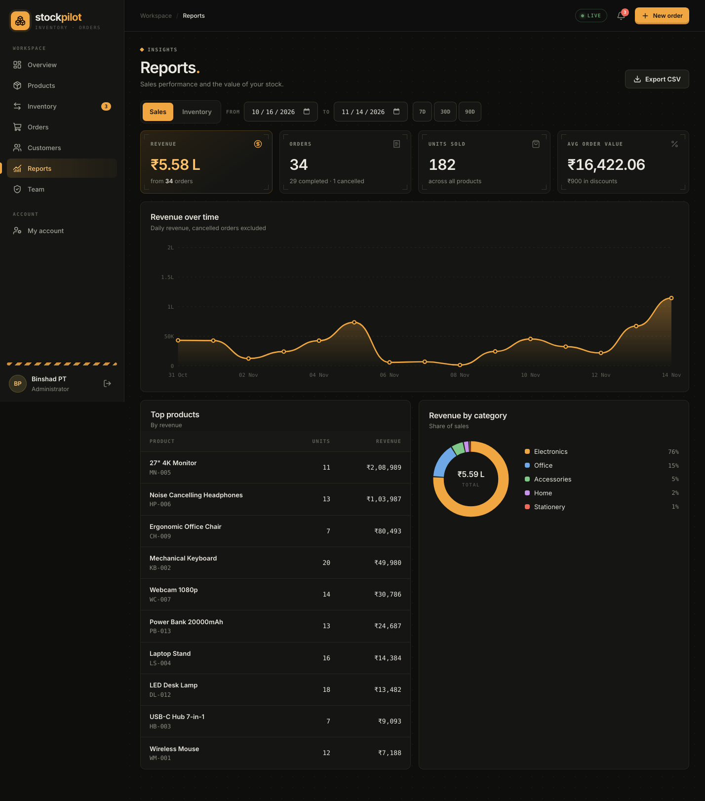
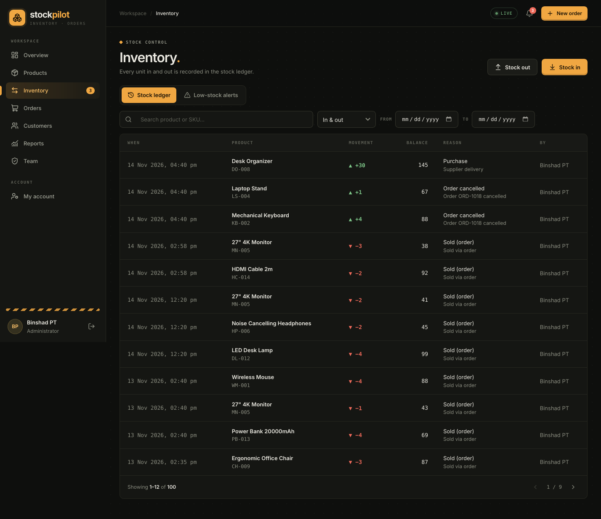

# StockPilot · Smart Inventory & Order Management System

A full-stack inventory and order management system: **web app (React)**, **Android app (Kotlin)** and a **REST API (Node.js / Express)** sharing one **MongoDB** database.

> Built for the Codebxo Full Stack Developer Internship assessment.

| | |
|---|---|
| **Web app** | React 19 + Vite + React Router, custom responsive UI, hand-made SVG charts |
| **Android app** | Kotlin, XML layouts, ViewBinding, Retrofit + OkHttp, Material 3 (dark/amber theme) |
| **API** | Node.js, Express 5, Mongoose, JWT, bcrypt, Zod validation, Helmet, rate limiting, Swagger UI |
| **Database** | MongoDB (Atlas or local) · see [`docs/ER-DIAGRAM.md`](docs/ER-DIAGRAM.md) |

## Links (fill these in before submitting)

- Live web app: `https://…`
- Backend API: `https://…`  ·  API docs (Swagger): `https://…/api/docs`
- Android APK: `…` (or build it yourself — see [Android](#android-app))
- Demo accounts: **admin** `admin@stockpilot.com` / `Admin@123` · **staff** `staff@stockpilot.com` / `Staff@123`

## Screenshots

| | |
|---|---|
|  |  |
|  |  |

Phone layout: [dashboard](docs/screenshots/phone-dashboard.png) · [new order](docs/screenshots/phone-new-order.png) · [login](docs/screenshots/phone-login.png)

## Assessment checklist

| Required module | Where it lives |
|---|---|
| 1. Authentication — login, logout, role-based access | `backend/routes/auth.js`, `middleware/auth.js` · web `pages/Login.jsx` · Android `LoginActivity` |
| 2. Dashboard — products, stock, orders, sales | `routes/dashboard.js` · web `pages/Dashboard.jsx` · Android `DashboardFragment` |
| 3. Product management — add, edit, delete, search | `routes/products.js` · web `pages/Products.jsx` · Android `ProductsFragment` |
| 4. Inventory — stock-in, stock-out, low-stock alerts | `routes/inventory.js`, `services/stockService.js` · web `pages/Inventory.jsx` |
| 5. Customers — add and manage | `routes/customers.js` · web `pages/Customers.jsx` · Android `CustomersFragment` |
| 6. Orders — create, stock updates automatically | `routes/orders.js`, `services/orderService.js` · web `pages/NewOrder.jsx`, `Orders.jsx` · Android `NewOrderActivity` |
| 7. Reports — sales and inventory (+ CSV export) | `routes/reports.js` · web `pages/Reports.jsx` |

| Technical requirement | How it is covered |
|---|---|
| Responsive frontend with API integration | Sidebar → drawer + bottom tab bar on phones, tables turn into cards, bottom-sheet dialogs |
| REST API, auth, validation, business logic | Zod schemas, JWT, central error handler, atomic stock logic |
| Mobile app | Native Android app using the same API |
| Database design | 6 collections with relations, indexes and an audit ledger — [`docs/ER-DIAGRAM.md`](docs/ER-DIAGRAM.md) |
| Server deployment | [`docs/DEPLOYMENT.md`](docs/DEPLOYMENT.md) (Render + MongoDB Atlas + Vercel/Netlify) |
| API documentation | Swagger UI at `/api/docs` + [`docs/API.md`](docs/API.md) |
| Tests | 12 automated integration tests (`npm test`) |

## Roles

| Capability | Admin | Staff |
|---|:-:|:-:|
| View dashboard, products, customers, orders, stock ledger | ✅ | ✅ |
| Stock in / stock out | ✅ | ✅ |
| Add / edit customers · create orders · mark orders completed | ✅ | ✅ |
| Add / edit / delete products | ✅ | – |
| Delete customers · **cancel orders** (returns stock) | ✅ | – |
| Reports (+ CSV) · manage users and roles | ✅ | – |

Rules are enforced **on the server** (the UI only hides what you can't do). Public registration always creates `staff`; the very first account in an empty database becomes `admin`.

## Business logic worth knowing

- **Creating an order deducts stock automatically**, using atomic conditional updates (`stock >= qty`). Two people can't sell the last unit twice, and if any line fails the whole order is rolled back.
- **Cancelling an order returns the stock.** Order numbers (`ORD-1001`…) come from a safe counter.
- **Every stock change is logged** in a ledger (who, why, when, balance after). Stock is never edited directly on a product.
- **Prices come from the database**, never from the client. Order lines keep a snapshot of name/SKU/price so history never changes.
- Inputs are validated with Zod; errors are returned in one consistent JSON shape; search input is regex-escaped.

## Run it locally

Requirements: **Node 18+**, a **MongoDB** connection string (free [Atlas](https://www.mongodb.com/atlas) cluster, or local MongoDB).

### 1. Backend

```bash
cd backend
npm install
cp .env.example .env        # then edit .env: MONGO_URI and JWT_SECRET
npm run seed                # optional demo data (WIPES the database it points to)
npm run dev                 # http://localhost:5000  ·  docs at /api/docs
```

Generate a strong secret: `node -e "console.log(require('crypto').randomBytes(48).toString('hex'))"`

Other scripts: `npm test` (integration tests, need a MongoDB — set `TEST_MONGO_URI`, default `mongodb://127.0.0.1:27018/stockpilot_test`), `npm run make-admin -- someone@example.com`.

### 2. Web app

```bash
cd frontend
npm install
cp .env.example .env        # VITE_API_URL=http://localhost:5000
npm run dev                 # http://localhost:5173
```

Production build: `npm run build` → `dist/`.

### 3. Android app

1. Open the `android/` folder in **Android Studio** (Koala or newer; JDK 17). Let Gradle sync.
2. Set the API address in `android/gradle.properties` → `API_BASE_URL`
   - emulator + backend on your PC: `http://10.0.2.2:5000/` (default)
   - deployed backend: `https://your-api.onrender.com/` (must end with `/`)
3. Run on an emulator/device, or build an APK: **Build → Build Bundle(s)/APK(s) → Build APK(s)**
   The APK appears in `android/app/build/outputs/apk/debug/app-debug.apk`. (Android Studio creates the Gradle wrapper on first sync.)

The app has: sign-in, dashboard, product list/search with stock-in/out (and add product for admins), customers, orders (view, complete, cancel for admins) and a new-order screen with quantity steppers.

## Project structure

```
StockPilot/
├── backend/                 Express REST API
│   ├── models/              User, Product, Customer, Order, StockMovement, Counter
│   ├── routes/              auth, users, products, inventory, customers, orders, dashboard, reports
│   ├── services/            stockService (atomic stock changes), orderService (create / cancel)
│   ├── middleware/          auth + roles, validation, uploads, error handler
│   ├── docs/openapi.js      Swagger/OpenAPI description
│   ├── tests/               integration tests
│   └── seed.js              demo data
├── frontend/                React web app (pages/, components/, context/, utils/)
├── android/                 Kotlin Android app (app/src/main/java/com/stockpilot/app)
├── docs/                    ER diagram, API reference, deployment guide
└── render.yaml              one-click backend deploy blueprint for Render
```

## Security notes

- Passwords are hashed with bcrypt; JWT secret is required at startup; `.env` is git-ignored — **never commit real credentials**.
- Role and active status are re-checked from the database on every request, so disabling a user takes effect immediately.
- Helmet headers, CORS allow-list (`CLIENT_URL`), login/register rate limits, 5 MB image limit with type whitelist.
- Uploaded product images are stored on the server's disk. Free hosts (e.g. Render) wipe disk on redeploy; use a persistent disk or an image service (Cloudinary/S3) for long-term storage.
