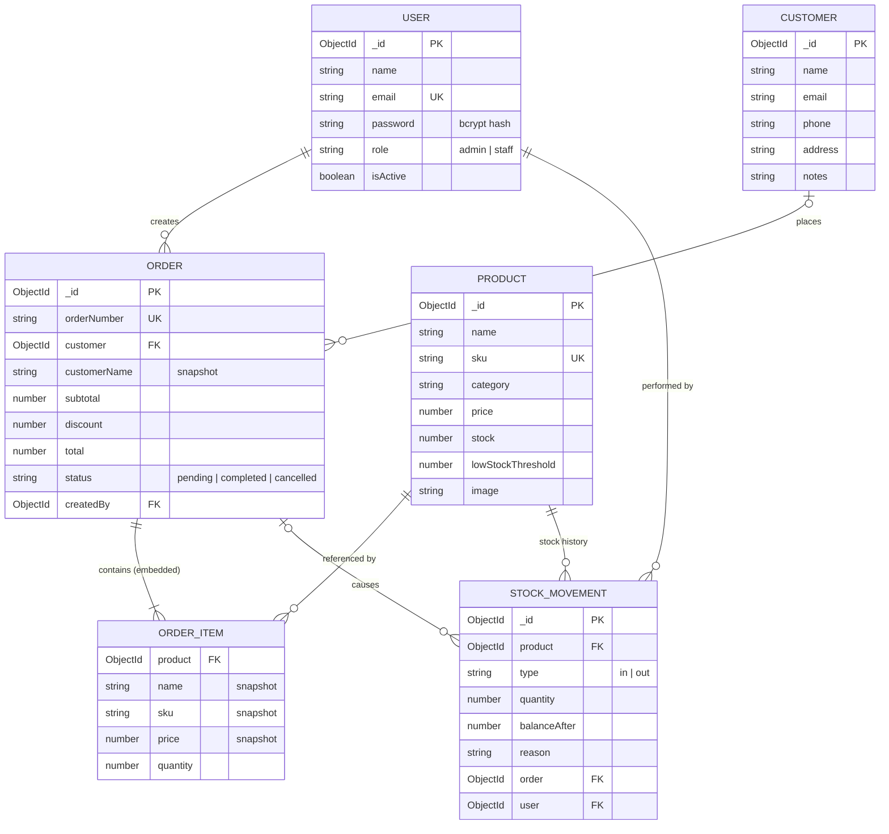

# Database design

StockPilot uses **MongoDB** (via Mongoose). The picture is in [`er-diagram.png`](er-diagram.png) / [`er-diagram.svg`](er-diagram.svg); the same thing as a Mermaid diagram (renders on GitHub):

## Design decisions (good to explain in an interview)

| Decision | Why |
|---|---|
| **Order items are embedded** in the order, with a copy (snapshot) of name, SKU and price | An order is always read as a whole, and its history must not change if the product is later edited or deleted. |
| **`StockMovement` ledger** is a separate collection | Every change to `Product.stock` is recorded with who/why/when and the balance afterwards, so stock can be audited and explained. |
| `Product.stock` is **only changed through one function** (`stockService.adjustStock`) | One place to enforce "never below zero" and to always write the ledger row. |
| Stock-out uses a **conditional atomic update** (`stock >= qty`) | Two people selling the last unit at the same time cannot oversell (covered by an automated test). |
| Creating an order **rolls back** already-deducted lines if a later line fails | Works on any MongoDB (no replica-set transactions needed), so the order is all-or-nothing. |
| `Counter` collection | Produces sequential order numbers (`ORD-1001`, `ORD-1002`…) safely under concurrency. |
| Indexes on `sku`, `email`, `orderNumber` (unique) and on `createdAt`, `status`, `customer` | Fast lookups and the dashboard/report queries. |
| Prices and totals are **calculated on the server** from the database | The client can never send a fake price. |
